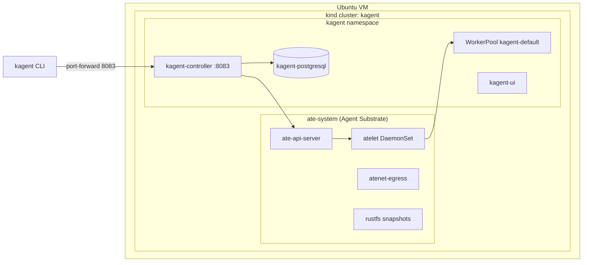

# 01 · Setup: kagent 1.0 and Agent Substrate on one Ubuntu VM

This chapter documents the installation that was run during the exploration. It takes a fresh Ubuntu
24.04 VM to a running kagent control plane with an Agent that answers a message.

Expected time: about 20 minutes, most of it image pulls and the first snapshot build.

## What you need

| Item | Version used | Notes |
|---|---|---|
| Ubuntu VM | 24.04.5 LTS | Verified on 4 vCPU and 15 GiB RAM at install; the same VM later reported 8 vCPU and 31 GiB. 30 GiB disk. `/dev/kvm` present but not required for the gVisor sandbox class. |
| SSH access | key-based | Use a key you own. Never commit it. |
| Docker | 29.x | `docker.io` from Ubuntu packages |
| kubectl | v1.37.0 | Must match the kind node image |
| kind | v0.32.0 | |
| Helm | 3.22.x | |
| kagent CLI | 1.0.0 | Installer script, pinned |
| Tailscale | 1.104.x | Optional. Used to reach a model gateway on another machine (chapter 03). |

kagent 1.0 requires Kubernetes **1.37 or later** with the `PodCertificateRequest` and
`ClusterTrustBundle` APIs (`certificates.k8s.io/v1`). The kind node image
`kindest/node:v1.37.0` provides them.

## Architecture of the install



## Step 1 · Connect and check the machine

```bash
ssh -i <path-to-your-key.pem> azureuser@<vm-public-ip>

lsb_release -ds
nproc
free -h | head -2
df -h / | tail -1
ls -l /dev/kvm 2>/dev/null || echo "no /dev/kvm (fine for a gVisor-only install)"
```

Expected: Ubuntu 24.04, at least 4 vCPU, 15 GiB RAM or more, and 25 GiB or more free disk. The install was verified at 4 vCPU and 15 GiB; the decision-guide timings were taken at that size.

> **Key permissions on Windows.** If OpenSSH refuses the key with "Bad permissions",
> restrict the file to your user only:
> `icacls <key.pem> /inheritance:r /grant:r "%USERNAME%:(R)"`

## Step 2 · Install Docker, kubectl, kind, and Helm

```bash
sudo apt-get update -y
sudo apt-get install -y ca-certificates curl docker.io
sudo systemctl enable --now docker
sudo usermod -aG docker "$USER"

# kubectl matching the kind node image
curl -fsSLo /tmp/kubectl "https://dl.k8s.io/release/v1.37.0/bin/linux/amd64/kubectl"
sudo install -m 0755 /tmp/kubectl /usr/local/bin/kubectl

# kind v0.32.0
curl -fsSLo /tmp/kind "https://kind.sigs.k8s.io/dl/v0.32.0/kind-linux-amd64"
sudo install -m 0755 /tmp/kind /usr/local/bin/kind

# Helm 3
curl -fsSL https://raw.githubusercontent.com/helm/helm/main/scripts/get-helm-3 | bash
```

The `usermod` change takes effect at the next login. Until then, run Docker commands
through `sg docker -c "..."`, as this guide does.

Verify:

```bash
kubectl version --client
kind version
helm version --short
sg docker -c "docker version --format '{{.Server.Version}}'"
```

## Step 3 · Install the kagent CLI

```bash
curl -fsSL https://raw.githubusercontent.com/kagent-dev/kagent/refs/heads/main/scripts/get-kagent \
  | bash -s -- --version v1.0.0
kagent version
```

Expected: `"kagent_version":"1.0.0"`.

## Step 4 · Create the cluster

```bash
sg docker -c "kind create cluster --name kagent --image kindest/node:v1.37.0"
kubectl cluster-info --context kind-kagent
kubectl api-resources --api-group=certificates.k8s.io
```

The last command must list `podcertificaterequests` and `clustertrustbundles`.

## Step 5 · Write the install configuration

The first file turns on gRPC reflection, so `grpcurl` can discover services.

```bash
cat > kagent-values.yaml <<'EOF'
config:
  server:
    grpcReflection: true
EOF

cat > kagent-config.yaml <<'EOF'
install:
  kagent:
    valuesFiles: [kagent-values.yaml]
EOF
```

## Step 6 · Dry run (recommended)

A dry run writes the Helm commands and values without touching the cluster.

```bash
kagent --config kagent-config.yaml install --namespace kagent \
  --dry-run --output-dir kagent-dryrun
ls kagent-dryrun
```

The generated `install.sh` reads `OPENAI_API_KEY` and creates a Secret from it. You can
supply any model key here and change the model later with a ModelConfig (chapter 03).
Do not commit the output directory.

## Step 7 · Install kagent

```bash
export OPENAI_API_KEY="<your-key-or-placeholder>"   # never paste keys into files
sg docker -c "kagent --config kagent-config.yaml install --namespace kagent"
kubectl rollout status deployment/kagent-controller -n kagent --timeout=300s
```

This takes about four minutes on a fresh VM. The first run also builds the golden
snapshot for the default WorkerPool.

## Step 8 · Verify the install

```bash
kubectl get pods -n kagent
kubectl get pods -n ate-system
kubectl get workerpools -n kagent
kagent agent list
```

Expected:

- `kagent` namespace: `kagent-controller`, `kagent-default` (WorkerPool pod),
  `kagent-postgresql`, `kagent-tools`, and `kagent-ui`, all `Running`.
- `ate-system`: `ate-api-server` (2 replicas), `ate-controller`, `ate-idp-server`,
  the `atelet` DaemonSet, `atenet-egress`, `atenet-router`, `k8s-credential-provider`,
  and `rustfs`. The `rustfs-bucket-init` pod shows `Completed`.
- WorkerPool `kagent-default`: `READY 1`, `SANDBOXCONFIG gvisor-default`, `RESOLVED True`.

## Step 9 · Reach the controller

The controller serves gRPC and A2A on port 8083. Keep that port inside the VM and
reach it with a port-forward.

```bash
kubectl port-forward -n kagent svc/kagent-controller 8083:8083
```

Leave it running. In a second shell, read an agent card to confirm the A2A endpoint:

```bash
curl -s http://localhost:8083/agents/kagent/my-first-agent/.well-known/agent-card.json | head -c 300
```

Optional UI: `kubectl port-forward -n kagent svc/kagent-ui 8082:8080`, then open
<http://localhost:8082>.

## Step 10 · Smoke-test an agent

This step uses the `default-model-config` that the installer creates, which points at the
OpenAI API with the key you supplied. If you have no OpenAI key, skip it and continue
with chapter 03, which routes an Agent through your own gateway.

```bash
kubectl apply -f examples/01-setup/smoke-agent.yaml
kubectl get agent my-first-agent -n kagent \
  -o jsonpath="{range .status.conditions[*]}{.type}={.status} {.message}{'\n'}{end}"
```

Wait for `Ready=True`. The first build of the golden snapshot takes about a minute.

```bash
export SESSION_ID=$(kagent agent session create --agent my-first-agent -o json | jq -r '.session.id')
kagent agent invoke --session $SESSION_ID --task "What is 2+2? Answer in one short sentence."
```

## Troubleshooting

| Symptom | Likely cause | Check |
|---|---|---|
| `Bad permissions` on the key | Windows ACL too open | `icacls` command in Step 1 |
| `kubectl` cannot reach `localhost:8080` | Kubeconfig points nowhere; kind cluster was deleted or not created | `kind get clusters`, then `kubectl config use-context kind-kagent` |
| Controller pod in `CrashLoopBackOff` | kubectl/kind version mismatch | `kubectl version --client` must be v1.37.x |
| `ate-api-server` pending | Certificate pools missing | `kubectl get pods -n ate-system` |
| Agent `ActorTemplateRetrying` with `GoldenActorCrashed` | Image the Workers cannot pull, or the image has no `/bin/sh` for a shell entrypoint | `kubectl logs -n kagent deploy/kagent-controller --tail=400 \| grep "golden build failed"` |
| `GoldenActorCrashed` mentioning `HTTP response to HTTPS client` | Local registry is plain HTTP; Substrate pulls over HTTPS | Chapter 04, "Image registry" |
| Invoke returns `TASK_STATE_FAILED` with `connection refused` on `127.0.0.1:8080` | The agent's own server did not start inside the Actor | Chapter 04, "Single-process startup" |

## Clean-up (optional)

```bash
kind delete cluster --name kagent
```

This removes every agent, snapshot, and transcript on the cluster. Do not run it on a
machine where you want to keep the work.
