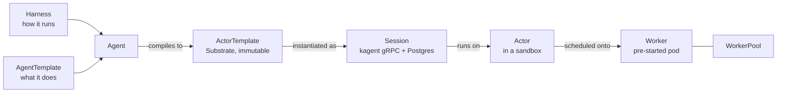
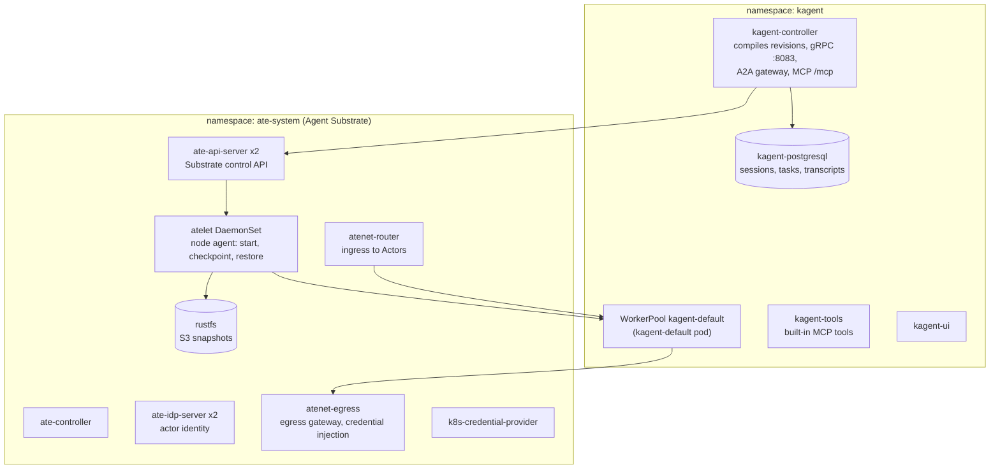
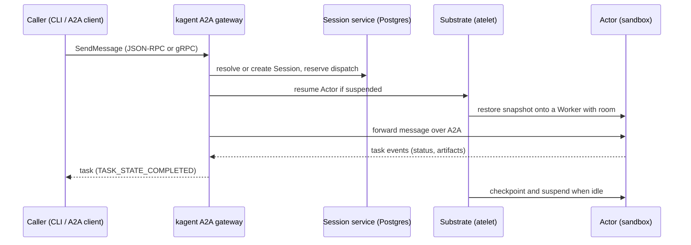

# 02 · Architecture: how kagent and Agent Substrate fit together

This chapter explains the system as it behaves on the cluster. Every component named
here was observed running in the verified install (chapter 01).

## The short version

kagent turns an agent definition into a sandboxed, suspendable process. Agent Substrate
runs that process. Your definition is three Kubernetes objects (Harness, AgentTemplate,
Agent). A conversation is a Session, which is backed by an Actor that runs on a Worker.

## Resources you author

| Resource | Kind | Defines | Notes |
|---|---|---|---|
| **Harness** | CRD `api.kagent.dev/v1alpha3` | The runtime: `kagent`, `codex`, `claude`, or `byo`; image; command; env; WorkerPool; snapshot location | Exactly one harness block. Applying it runs nothing. |
| **AgentTemplate** | CRD | Model (`modelConfig`), system prompt, tools (MCP or sub-agent), skills | Runs nothing alone. |
| **Agent** | CRD | Pairs one template with one Harness | Owns readiness: `Accepted`, `ResolvedRefs`, `Compatible`, `Ready`. |
| **ModelConfig** | CRD | One provider endpoint and its credential Secret | Chapter 03. |
| **SandboxTemplate** | CRD | Tools image, WorkerPool, egress policy refs | Chapter 05. |
| **Session** | Not a CRD | One conversation with one Agent | Created through kagent's gRPC API; stored in PostgreSQL. |
| **Actor** | Substrate object | The sandboxed unit that runs a Session's loop | Suspends to a snapshot between turns. |

The distinction that matters: the three CRDs live in the Kubernetes authorization plane
(RBAC), while a Session lives in kagent's own gRPC authorization plane. Someone who can
apply an Agent cannot necessarily read another user's Session.

## Components running on the cluster

What each part does, as observed:

- **kagent-controller** is the only component that reads your CRDs. It compiles each
  Agent into an immutable revision and an ActorTemplate, serves the A2A gateway on 8083,
  and exposes an MCP endpoint at `/mcp`.
- **ate-api-server** is Substrate's control API. The controller calls it to create
  ActorTemplates and Actors.
- **atelet** runs on each node. It starts Workers, checkpoints an Actor's memory and
  filesystem to snapshot storage, and restores it on the next message.
- **atenet-egress** is the only route out of an Actor. It authorizes every connection
  against the Actor's policy and injects credentials into approved requests, so the key
  never enters the agent. Chapter 06 covers a gap in its enforcement.
- **rustfs** is an S3-compatible bucket that holds snapshots. Production installs point
  this at real object storage.

## Lifecycle of one message

The caller addresses the Agent, not the Actor. The Session ID becomes the A2A
`contextId`, so a second message with the same ID continues the conversation.

## Two protocols, one port

The controller serves two caller-facing protocols on port 8083. Both were tested against
the same agent and returned the same task shape.

| Transport | How the Agent is selected | Verified |
|---|---|---|
| JSON-RPC over HTTP | URL path `POST /agents/{namespace}/{name}` | Yes (`SendMessage`, `ListTasks`) |
| gRPC (`lf.a2a.v1.A2AService`) | `tenant` field `namespace/name` | Yes (`SendMessage`, reflection) |

The agent card advertises both as `supportedInterfaces`. JSON-RPC requires the header
`A2A-Version: 1.0`; without it the call is rejected with a version error.

## What runs inside an Actor (BYO contract)

A `byo` Harness runs an image that you build. kagent places a fixed contract on it:

- Serve gRPC `lf.a2a.v1.A2AService` on **port 80**. The agent card hard-codes this address.
- Answer `GET /readyz` on **port 8081**. Substrate probes it before marking the Actor ready.
- Read the bootstrap descriptor from `KAGENT_BOOTSTRAP_JSON` and fetch the agent configuration.
- Keep state that must survive a suspend under `/data`, the only durable volume.

Chapter 04 builds an image against this contract and documents what the contract does
and does not check.

## Where kagent stops and you start

| kagent owns | You own |
|---|---|
| Compiling the Agent, the revision digest, and the ActorTemplate | The agent's code, prompt logic, and tool implementations (for BYO) |
| Scheduling onto Workers, suspend and resume, snapshots | The image contents and its dependencies |
| The A2A gateway, Session storage, task history | Business-level authorization on top of the gateway |
| Credential injection at the gateway | Choosing which destinations to allow |
| Readiness and revision status on the Agent | Monitoring beyond the conditions |

## Versions verified

| Component | Version |
|---|---|
| kagent (controller, CLI, golang-adk harness) | 1.0.0 |
| Agent Substrate (ate-*, atelet, atenet-*) | 1.0.0 |
| Kubernetes (kind node) | 1.37.0 |
| Microsoft Agent Framework (Go) | v0.3.1 |
| a2a-go (kagent's A2A library) | v2.8.0 |
| Go toolchain used for builds | 1.27.x |
