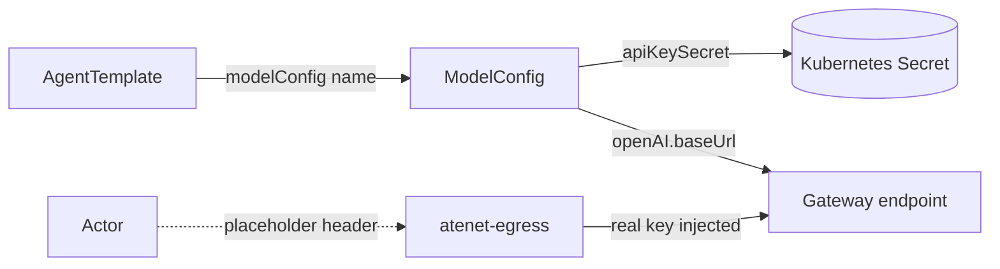

# 03 · Models: routing kagent through an OpenAI-compatible gateway

kagent reaches a model through a ModelConfig. The `provider: OpenAI` path with a
custom `baseUrl` accepts any server that implements the OpenAI API, including a local
gateway. This chapter wires one up and verifies it, including the one API-shape detail
that decided which endpoint works.

## What a ModelConfig holds



The Actor sends a placeholder credential. The egress gateway replaces it with the real key
on the way out, so the key never enters the sandbox. Chapter 06 explains the limits of
that guarantee.

## Prerequisites

- A kagent install from chapter 01.
- An OpenAI-compatible gateway reachable from the cluster. This guide used an
  a self-hosted OpenAI-compatible gateway on a workstation, exposed over Tailscale. Any gateway that
  serves `/v1/responses` or `/v1/chat/completions` works.
- The gateway API key, supplied through an environment variable.

## Step 1 · Reach the gateway from the VM

Use a private network path. Do not expose the gateway publicly to make this work.

On the gateway host, expose the local HTTP port over HTTPS inside your tailnet:

```bash
tailscale serve --bg --https=8443 http://127.0.0.1:20128
```

On the VM, confirm the path with a verified certificate (no `-k`):

```bash
export GATEWAY_URL=https://<gateway-host>.<tailnet>.ts.net:8443/v1
curl -sS -o /dev/null -w "%{http_code}\n" "$GATEWAY_URL/models" \
  -H "Authorization: Bearer $GATEWAY_KEY"
```

Expected: `200`. A `wrong version number` error means the port speaks plain HTTP, so
use `http://` for an in-tailnet link or add TLS in front of it.

## Step 2 · Choose the endpoint shape

Test both shapes on the model you plan to use. This guide found that the Responses API
worked and Chat Completions returned `400` for the same model on this gateway.

```bash
# Responses API
curl -sS "$GATEWAY_URL/responses" -H "Authorization: Bearer $GATEWAY_KEY" \
  -H "Content-Type: application/json" \
  -d '{"model":"<model-id>","input":"Say ok"}' | jq -r '.status // .error.message'

# Chat Completions
curl -sS "$GATEWAY_URL/chat/completions" -H "Authorization: Bearer $GATEWAY_KEY" \
  -H "Content-Type: application/json" \
  -d '{"model":"<model-id>","messages":[{"role":"user","content":"Say ok"}]}' \
  | jq -r '.choices[0].message.content // .error.message'
```

The Go Agent Framework provider (chapter 04) uses the Responses API by default, so pick
the shape that the gateway accepts for your model.

## Step 3 · Store the key in a Secret

Never write the key into a manifest. Create the Secret from an environment variable:

```bash
kubectl create secret generic gateway-auth -n kagent \
  --from-literal=GATEWAY_API_KEY="$GATEWAY_KEY" \
  --dry-run=client -o yaml | kubectl apply -f -
```

## Step 4 · Create the ModelConfig

`examples/03-models/modelconfig.yaml` holds the template. Apply it with the placeholders
filled in:

```bash
sed -e "s|<gateway-base-url>|$GATEWAY_URL|" \
    -e "s|<model-id>|<model-id>|" \
    examples/03-models/modelconfig.yaml | kubectl apply -f -

kubectl get modelconfig gateway-model -n kagent \
  -o jsonpath="{range .status.conditions[*]}{.type}={.status} {.message}{'\n'}{end}"
```

Expected: `Accepted=True` and `ResolvedRefs=True`.

## Step 5 · Verify tool calling

kagent sends a `tools` array on every request, even when an agent binds no tools. A
gateway that rejects that array fails every turn with a generic `400`. Check it directly:

```bash
curl -sS "$GATEWAY_URL/chat/completions" -H "Authorization: Bearer $GATEWAY_KEY" \
  -H "Content-Type: application/json" -d '{
    "model":"<model-id>",
    "messages":[{"role":"user","content":"Call the get_time tool."}],
    "tools":[{"type":"function","function":{"name":"get_time",
      "description":"Get current time","parameters":{"type":"object","properties":{}}}}],
    "tool_choice":"auto"}' | jq -c '.choices[0].finish_reason'
```

Expected: `"tool_calls"`. This guide's run returned that for the test model (a placeholder model ID here).

## Results from this exploration

| Check | Result |
|---|---|
| Gateway over verified HTTPS (tailnet) | `200` |
| Gateway over plain HTTP | `200`; HTTPS on the same port returned "wrong version number" |
| Responses API for the test model | Works |
| Chat Completions for the same model | `400` (upstream Vertex AI rejected the request) |
| Tool-call round trip | `finish_reason: tool_calls` |
| Persona instructions honored | Yes, in a direct call (pirate test). See chapter 04 for the in-cluster result. |

## Notes

- **Model IDs.** Gateways route on their own IDs (often prefixed). Use the ID the gateway
  lists, not the upstream vendor name.
- **HTTPS vs HTTP.** Substrate pulls *images* over HTTPS, and a plain-HTTP local registry
  fails (chapter 04). Model calls are separate: the gateway URL here is HTTPS through
  Tailscale because the verified certificate avoids `tls.disableVerify`.
- **Key rotation.** Update the Secret; the gateway cache refreshes within minutes. This
  guide did not measure the refresh window.
