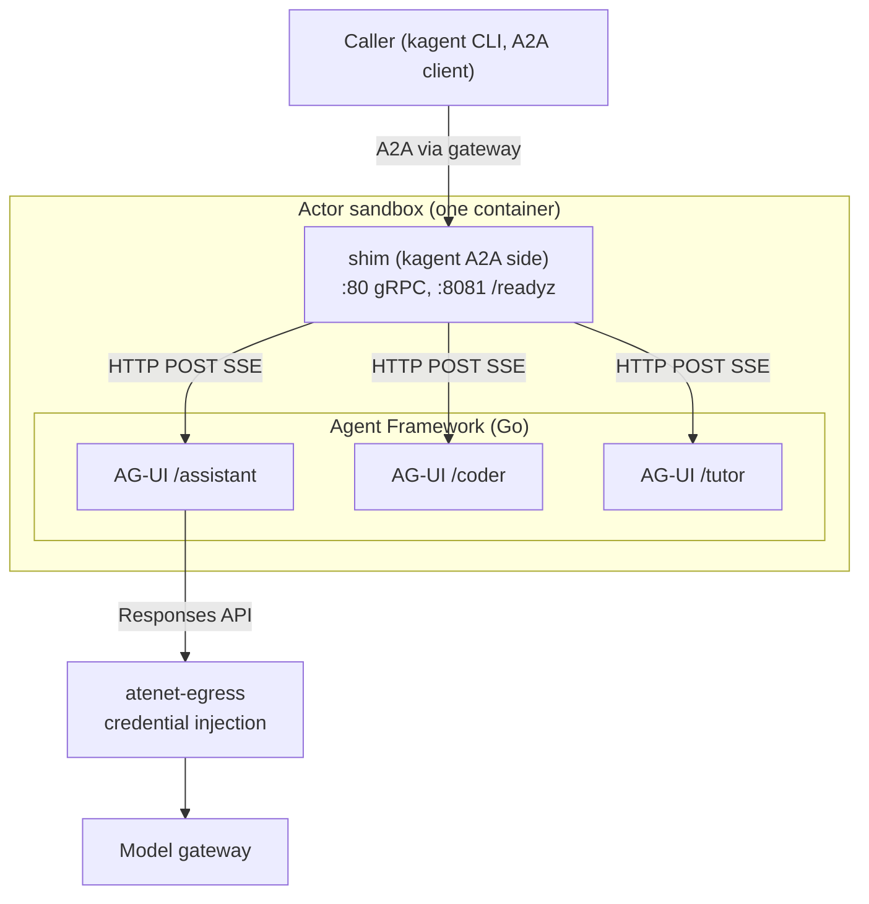

# 04 · BYO agents: three Microsoft Agent Framework agents on kagent

This chapter builds a `byo` Harness: a container image that kagent runs in a sandbox
and talks to over A2A. The image contains three agents written with the Microsoft Agent
Framework Go SDK, each served over AG-UI, plus a small shim that makes them reachable
through kagent's A2A contract.

The build also surfaced the most useful lessons of the whole exploration, so the
failures are documented next to the steps.

## Architecture of the image



Chapter 02 covers the contract. In short: the shim must serve gRPC on port 80 and
`/readyz` on 8081, and it must read its configuration from the bootstrap descriptor.

## Prerequisites

- Chapter 01 cluster, and chapter 03 ModelConfig.
- A Go 1.27 toolchain. This guide built inside `golang:1.27` containers, so no local Go
  install is needed.
- A kagent v1.0.0 source checkout next to this repo (the module is pinned there):

```bash
git clone --depth 1 --branch v1.0.0 https://github.com/kagent-dev/kagent.git ../kagent
```

## Step 1 · Understand the three personas

The agents differ only by instructions. They are defined in
`examples/02-byo-agui-shim/cmd/shim/main.go`:

```go
var personas = map[string]string{
    "assistant": "You are a concise general assistant.",
    "coder":     "You are a careful coding assistant. Answer with short code.",
    "tutor":     "You are a patient tutor. Explain step by step in simple words.",
}
```

Each persona is served at `/<name>` on `127.0.0.1:8080`. An AG-UI client posts a run
and reads Server-Sent Events. The A2A side reads the same events and returns the reply
text.

## Step 2 · Read the shim

The shim has three jobs, in this order:

1. **Bootstrap.** `config.MaterializeFromBootstrap` fetches the revision's configuration
   and `config.LoadAgentConfig` reads it. kagent's own Go helper does this.
2. **Start the AG-UI servers in-process.** `startAGUI` binds `127.0.0.1:8080` *before* the
   A2A server starts. This is the fix for the startup race described below.
3. **Serve A2A.** `app.New` with an executor that forwards each message to the persona's
   AG-UI endpoint and returns the streamed text.

The key is never in the image. The shim reads `GATEWAY_BASE_URL` and
`GATEWAY_MODEL`, and it sends the placeholder key `"placeholder"`. The gateway replaces
the header on the way out.

## Step 3 · Build the image

Use the module as published in `examples/02-byo-agui-shim/`. Point its `replace` at your
kagent checkout (it already says how), then build inside a Go container:

```bash
cd examples/02-byo-agui-shim
docker run --rm -v "$PWD:/src" -v "$PWD/../../../kagent/go:/kagent" -w /src \
  -e GOTOOLCHAIN=auto golang:1.27 \
  sh -c "go mod tidy && CGO_ENABLED=0 go build -trimpath -o /src/shim ./cmd/shim"
```

> The `replace` path in `go.mod` is relative (`../kagent/go`). Inside the container
> mount it at the same relative location, or edit the path. This guide's build used an
> absolute path to a checkout at `/kagent`.

The `Dockerfile` is in `examples/02-byo-agui-shim/Dockerfile`. It uses a distroless base
with no shell, which matters: see "Failure 2" below.

```bash
docker build -t localhost:5001/agui-agents:v3 .
```

## Step 4 · Put the image where Substrate can pull it

Substrate pulls images **over HTTPS** through its own image cache. A plain-HTTP registry
fails with `server gave HTTP response to HTTPS client`. This is the single most time-
consuming problem in the exploration (about 45 minutes), so read this carefully.

Working setup used here:

```bash
docker run -d --restart=always -p 127.0.0.1:5001:5000 --name kind-registry registry:2
docker network connect kind kind-registry
docker push localhost:5001/agui-agents:v3
```

Then configure atelet so `localhost` references are rewritten to the in-network
registry:

```bash
helm upgrade substrate-atelet oci://ghcr.io/kagent-dev/substrate/helm/substrate-atelet \
  --version 1.0.0 --namespace ate-system --reuse-values \
  --set 'atelet.extraArgs[0]=--localhost-registry-replacement=kind-registry:5000' \
  --wait
kubectl rollout status daemonset/atelet -n ate-system --timeout=5m
```

Verify the flag is on the running pod:

```bash
kubectl get ds atelet -n ate-system -o jsonpath="{.spec.template.spec.containers[0].args}" \
  | grep -o "localhost-registry-replacement[^\"]*"
```

Pin the image by digest for the Harness:

```bash
DIG=$(docker inspect --format='{{index .RepoDigests 0}}' localhost:5001/agui-agents:v3 | sed 's/.*@//')
echo "$DIG"
```

Two caveats recorded from the run:

- Atelet resolves `localhost` inside the node's network namespace, so `localhost:5001`
  alone fails; the rewrite is what makes it work.
- The registry has no authentication. Use it only on a host you control.

## Step 5 · Declare the three agents

`examples/02-byo-agui-shim/harness.yaml` holds the full set. The part that matters is the
Harness, which pins the image, sets the command, and passes the persona and gateway URL
as literal env values:

```yaml
apiVersion: api.kagent.dev/v1alpha3
kind: Harness
metadata:
  name: agui-assistant-harness
  namespace: kagent
spec:
  byo: {}
  workload:
    image: localhost:5001/agui-agents@<digest>
    command: ["/app/shim"]
  env:
    - name: AGUI_PATH
      value: assistant
    - name: GATEWAY_BASE_URL
      value: <gateway-base-url>
    - name: GATEWAY_MODEL
      value: <model-id>
  substrate:
    workerPoolRef:
      name: kagent-default
    snapshotPolicy:
      location: s3://ate-snapshots/kagent/
```

Do not put the gateway key in `env`. Harness env accepts only literal values. Use a
ModelConfig and the gateway injection path instead (chapter 03), and reference it from
the AgentTemplate with `modelConfig.name`.

Apply it, then wait for `Ready`:

```bash
kubectl apply -f examples/02-byo-agui-shim/harness.yaml
kubectl get agent agui-assistant -n kagent \
  -o jsonpath="{.status.conditions[?(@.type=='Ready')].status}"
```

## Step 6 · Invoke an agent and check the reply

Use JSON-RPC through the controller. The port-forward from chapter 01 must be running.

```bash
curl -sS -X POST http://localhost:8083/agents/kagent/agui-assistant \
  -H "Content-Type: application/json" -H "A2A-Version: 1.0" \
  -d '{"jsonrpc":"2.0","id":"1","method":"SendMessage","params":{"message":{
        "messageId":"hello-1","role":"ROLE_USER",
        "parts":[{"text":"Say hello in one short sentence."}]}}}' \
  | jq -r '.result.task.status.state, (.result.task.status.message.parts[0].text // .error.message)'
```

Expected: `TASK_STATE_COMPLETED` and a short greeting.

The host client in `examples/02-byo-agui-shim/cmd/client/` runs the same check against all three
agents and exits non-zero if any agent fails:

```bash
cd examples/02-byo-agui-shim && go build -o ../../client ./cmd/client && cd ../..
KAGENT_URL=http://localhost:8083 ./client
```

Last verified run:

```text
agui-assistant  state=TASK_STATE_COMPLETED   ok=true  reply="I'm a concise general assistant."
agui-coder      state=TASK_STATE_COMPLETED   ok=true  reply="I'm Claude, an AI assistant made by Anthropic."
agui-tutor      state=TASK_STATE_COMPLETED   ok=true  reply="I'm Claude, an AI assistant made by Anthropic."
PASS: 3 of 3 agents completed with a reply
```

## What the verification does and does not prove

- **Proves:** each Agent is Ready; each invoke completes through kagent's A2A path; each
  reply is non-empty model text from the gateway.
- **Does not prove:** that the personas behave differently. The coder and tutor replies
  say "I'm Claude". Chapter 06 covers the investigation: the Go provider sends the
  persona as `instructions` on the wire, and the gateway honors instructions on a direct
  call, but the in-cluster replies did not change. The cause was not isolated.
- **Does not prove:** AG-UI from outside the cluster. The controller exposes no AG-UI
  route for an Agent. AG-UI runs only inside the Actor, and the client uses A2A.

## Failures and what fixed them

These are in the order they happened. Each one is a lesson for BYO work on kagent.

### Failure 1: plain-HTTP registry (about 45 minutes)

Symptom: the Agent stayed `Ready=False` with `GoldenActorCrashed`, and the atelet log
read `server gave HTTP response to HTTPS client`.
Cause: Substrate's image cache pulls over HTTPS only, except for `localhost` references
when `--localhost-registry-replacement` is set.
Fix: the atelet flag from Step 4, plus `localhost:5001` refs in the Harness.

Trying a Tailscale-served HTTPS registry did not work: the kind node could not reach the
tailnet IP, and that exposure was reverted.

### Failure 2: shell entrypoint in a distroless image

Symptom: `failed to load /bin/sh: no such file`, in the worker's container log.
Cause: the image was `distroless/base`, with no shell, and the entrypoint was
`/bin/sh /app/entrypoint.sh`.
Fix: a small Go launcher, then (later) removing the launcher entirely (see Failure 3).

Lesson: check what a distroless image contains before you use a shell command as the
entrypoint. `docker run --rm --entrypoint /bin/sh <image>` answers it in one line.

### Failure 3: two processes and a startup race

Symptom: every invoke failed with `connection refused` on `127.0.0.1:8080`, from inside the
Actor, across three retries.
Cause: the launcher started the AG-UI server as a child process, then `exec`'d the shim.
The shim took requests before the server was listening, and the child did not survive
the Actor's suspend and restore cycle.
Fix: one process. `startAGUI` binds the listener before `app.New` starts, so the A2A side
never sees the server down. The image contains only `/app/shim`.

Lesson: under Substrate, an Actor is one process tree that is checkpointed as a unit.
Background children are fragile. Keep the BYO image to one process you control.

### Failure 4: the wrong `localhost` rewrite

Symptom: after the atelet flag was set, the golden build still failed, with
`dial tcp [::1]:5001: connection refused`.
Cause: I first pointed the Harness at `localhost:5001` while atelet's rewrite target was
`kind-registry:5000`. The rewrite is applied to the reference, and the Harness must use
the `localhost` form. The docs' tip about the flag was the answer, and I had missed it.
Fix: follow the upstream BYO example's flag and reference form exactly.

### Failure 5: an invalid bootstrap descriptor

Symptom: running the image outside kagent logged `invalid bootstrap control-plane URL`
and the container exited.
Cause: the shim expects the controller to inject `KAGENT_BOOTSTRAP_JSON`. Outside an
Actor it is absent.
Fix: test the AG-UI servers alone (outside the shim) to check the model path, and test
the full shim only inside the cluster. This is expected behavior, not a bug.

## Hygiene for the examples

- The gateway key was pasted into several commands during the exploration. Rotate it.
  The examples here never contain it.
- `env` on a Harness is visible in the object. Keep it to non-secret settings.

## Reproducing the three personas check

The persona test is the open question of this chapter. To try it:

```bash
kubectl port-forward -n kagent svc/kagent-controller 8083:8083 &
for a in assistant coder tutor; do
  curl -sS -X POST http://localhost:8083/agents/kagent/agui-$a \
    -H "Content-Type: application/json" -H "A2A-Version: 1.0" \
    -d '{"jsonrpc":"2.0","id":"p","method":"SendMessage","params":{"message":{
          "messageId":"p-'$a'-'$RANDOM'","role":"ROLE_USER",
          "parts":[{"text":"Say hello."}]}}}' \
    | jq -r '.result.task.status.message.parts[0].text'
done
```

If the three lines differ in style, the personas are reaching the model. In the verified
run they did not.
