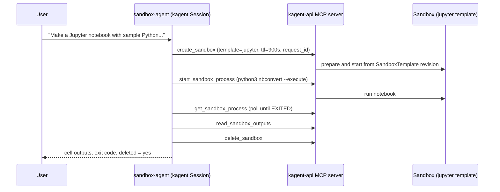

# 05 · Sandbox agent: a request becomes a Jupyter notebook run

This chapter builds an agent that manages sandboxes for a user. A plain-language
request, such as "make a Jupyter notebook with sample Python and run it", becomes four
platform calls: create a sandbox, write and execute a notebook, read the output, delete
the sandbox. The sandbox is kagent's isolated runtime, and the agent reaches it through
kagent's built-in MCP tools.

## Architecture



Two resources make this work:

| Resource | Role |
|---|---|
| **SandboxTemplate** `jupyter` | Image (Python + Jupyter + nbconvert), WorkerPool, snapshot location, no egress grants |
| **AgentTemplate + Agent** `sandbox-agent` | System prompt, model, and the seven sandbox tools it may call |

The template is the enforcement point for what a sandbox *contains*. The prompt is an
instruction to the model. Keep that distinction in mind when you review chapter 06.

## Prerequisites

- Chapter 01 cluster, and a model ModelConfig (chapter 03) named `gateway-model`.
- The sandbox guest image and sandbox values from kagent's sandbox docs.
- The Python base image pinned by digest. Look it up:

```bash
docker manifest inspect python:3.13-slim -v | jq -r 'if type=="array" then .[0].Descriptor.digest else .Descriptor.digest end'
```

Use the digest, not the tag. The API server rejects a tag without a digest.

## Step 1 · Enable sandboxes in the release

Create `sandbox-values.yaml` from the kagent sandbox documentation. It sets the guest
image and the per-sandbox allocation:

```yaml
config:
  sandboxes:
    guestImage: ghcr.io/kagent-dev/kagent/sandbox-guest@sha256:<digest-from-kagent-docs>
    cpu: "1"
    memory: 1Gi
    defaultTtl: 3600s
    maxTtl: 86400s
```

Apply it to the existing release, keeping its other values:

```bash
export KAGENT_CHART_VERSION=$(helm list -n kagent -o json \
  | jq -er '.[] | select(.name == "kagent") | .chart | ltrimstr("kagent-")')
helm upgrade kagent oci://ghcr.io/kagent-dev/kagent/helm/kagent \
  --namespace kagent --version "$KAGENT_CHART_VERSION" \
  --reuse-values -f sandbox-values.yaml --wait
kubectl rollout status deployment/kagent-controller -n kagent --timeout=5m
```

Verify that the values reached the release:

```bash
helm get values kagent -n kagent -o yaml | grep -A5 "sandboxes:"
```

## Step 2 · Create a plain Python template

`examples/03-sandbox-agent/` holds the Jupyter template. First, the plain template helps
you check the path without Jupyter:

```bash
kubectl apply -f - <<'YAML'
apiVersion: api.kagent.dev/v1alpha3
kind: SandboxTemplate
metadata:
  name: python
  namespace: kagent
spec:
  workload:
    image: docker.io/library/python@sha256:<python-digest>
  env:
    - name: LANG
      value: C.UTF-8
  substrate:
    workerPoolRef:
      name: kagent-default
    snapshotPolicy:
      location: s3://ate-snapshots/kagent/
YAML

kubectl get sandboxtemplate python -n kagent \
  -o jsonpath="{range .status.conditions[?(@.type=='Ready')]}{.status} {.reason}{'\n'}{end}"
```

Expected: `True Prepared`.

## Step 3 · Build the Jupyter image

The sandbox has no outbound network, so it cannot install Jupyter at run time. Bake it
in:

```dockerfile
# examples/03-sandbox-agent/Dockerfile.jupyter
FROM python@sha256:<python-digest>
RUN pip install --no-cache-dir jupyter nbconvert==7.* && pip cache purge || true
```

```bash
docker build -t localhost:5001/sandbox-jupyter:v1 -f examples/03-sandbox-agent/Dockerfile.jupyter .
docker push localhost:5001/sandbox-jupyter:v1
JUP_DIG=$(docker inspect --format='{{index .RepoDigests 0}}' localhost:5001/sandbox-jupyter:v1 | sed 's/.*@//')
```

Verify the tools exist in the image:

```bash
docker run --rm localhost:5001/sandbox-jupyter:v1 python -c "import jupyter_core; print('jupyter ok')"
```

## Step 4 · Create the Jupyter template

```bash
kubectl apply -f - <<YAML
apiVersion: api.kagent.dev/v1alpha3
kind: SandboxTemplate
metadata:
  name: jupyter
  namespace: kagent
spec:
  workload:
    image: localhost:5001/sandbox-jupyter@$JUP_DIG
  env:
    - name: LANG
      value: C.UTF-8
  substrate:
    workerPoolRef:
      name: kagent-default
    snapshotPolicy:
      location: s3://ate-snapshots/kagent/
YAML
```

Wait for `Ready=True`. The image must be pullable by the Worker, which is why the local
registry setup in chapter 04 applies here too.

## Step 5 · Create the sandbox agent

`examples/03-sandbox-agent/agent.yaml` is the complete AgentTemplate and Agent. Its
system prompt and tool list are the important parts:

- The prompt names the `jupyter` template, one sandbox per request, a retry with the same
  `request_id`, no package installs, and a delete before answering.
- The tools are a fixed list from `kagent-api`: `create_sandbox`, `start_sandbox_process`,
  `get_sandbox_process`, `read_sandbox_outputs`, `delete_sandbox`, and read-only helpers.

```bash
kubectl apply -f examples/03-sandbox-agent/agent.yaml
kubectl get agent sandbox-agent -n kagent \
  -o jsonpath="{range .status.conditions[*]}{.type}={.status} {.message}{'\n'}{end}"
```

Expected: `Ready=True`.

## Step 6 · Ask for a notebook

Send the request through A2A, with the port-forward from chapter 01 running:

```bash
curl -sS -m 800 -X POST http://localhost:8083/agents/kagent/sandbox-agent \
  -H "Content-Type: application/json" -H "A2A-Version: 1.0" \
  -d '{"jsonrpc":"2.0","id":"sb1","method":"SendMessage","params":{"message":{
        "messageId":"nb-req-1","role":"ROLE_USER",
        "parts":[{"text":"Create a Jupyter notebook sandbox with sample Python examples: one cell that prints the count and sum of [2, 3, 5] as JSON, and one cell that checks whether it can reach example.com. Run it and report the output. Delete the sandbox when done."}]}}}' \
  -o /tmp/sb.json
jq -r '.result.task.status.state' /tmp/sb.json
```

Expected: `TASK_STATE_COMPLETED`.

## Step 7 · Check what the agent actually did

The reply text is the model's summary. The tool calls are the evidence. List them:

```bash
jq -r '.result.task.artifacts[]?.parts[]? | select(.data.name) | "CALL \(.data.name) \(.data.args|tostring)"' /tmp/sb.json
jq -r '.result.task.artifacts[]?.parts[]? | select(.data.response) | "RESULT \(.data.name // "?") \(.data.response|tostring)"' /tmp/sb.json
```

From the verified run, the sequence was:

1. `create_sandbox` with `template: jupyter`, `ttl_seconds: 900`, and a `request_id`
2. `start_sandbox_process` writing the notebook with `python3 -c`
3. `start_sandbox_process` running `python3 -m jupyter nbconvert --execute` (exit 0)
4. `get_sandbox_process` polling until `PROCESS_STATE_EXITED`
5. `read_sandbox_outputs`, which returned the two cell outputs
6. `delete_sandbox`, which returned `RUNTIME_STATE_DELETED`

The decoded output from `read_sandbox_outputs` was:

```text
1 {"count": 3, "sum": 10}
2 blocked: True gaierror
```

Two calls in the verified run did not match the tool list or the plan: a `bash` call
(outside the bound tools) and a second `create_sandbox` with null arguments. Neither
left an orphan sandbox that I could find. Chapter 06 lists these as observations.

## Step 8 · Confirm nothing was left running

```bash
kagent sandbox list
```

The list should show no `RUNTIME_STATE_READY` entries for the sandbox you created. The
delete result in step 7 is the authoritative record.

## What this demonstrates, and what it does not

**Demonstrates**

- A user request can drive the full sandbox lifecycle through kagent's tools.
- Notebook execution works inside the sandbox, with nbconvert producing the output.
- The DNS-level network block holds for a hostname (`gaierror`).
- The memory limit holds: `MemTotal` inside the sandbox is 1 GiB (chapter 06).

**Does not demonstrate**

- Enforced isolation from the internet. A raw IP reached the internet from the same
  sandbox (chapter 06, finding F1). The prompt's "no outbound network" rule is an
  instruction, and the platform did not enforce it for IP destinations.
- CPU limits. The sandbox reported two CPUs and no cgroup CPU limit.

## Clean-up

```bash
kubectl delete agent sandbox-agent -n kagent
kubectl delete agenttemplate sandbox-agent -n kagent
```

Keep the `python` and `jupyter` templates if you want to rerun the chapter. Delete them
with `kubectl delete sandboxtemplate <name> -n kagent`.
